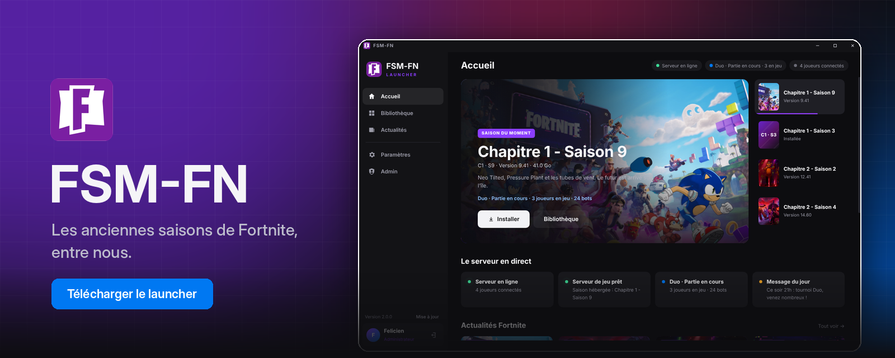
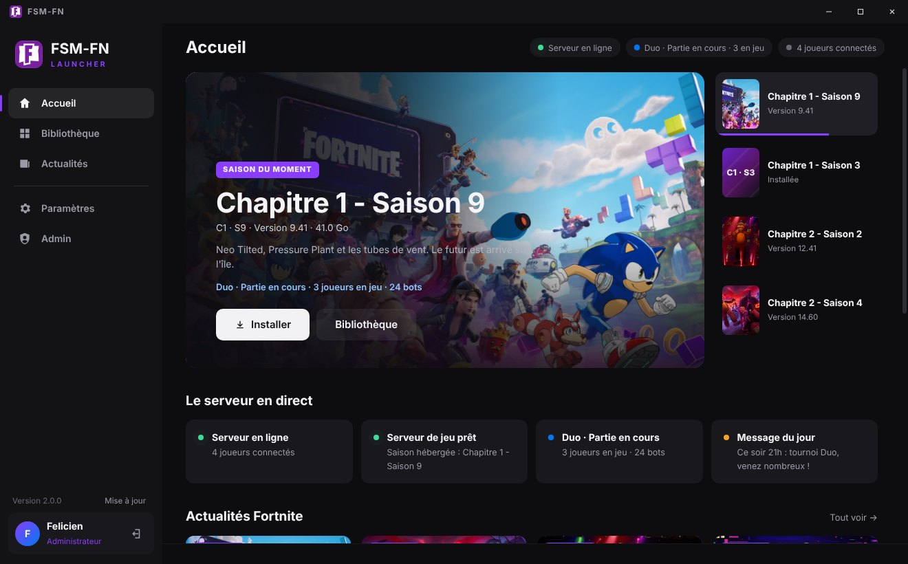
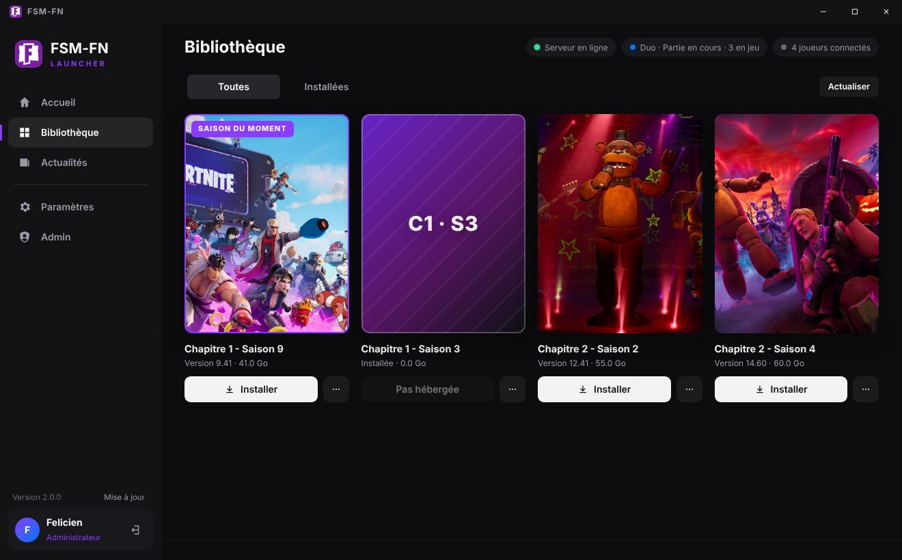
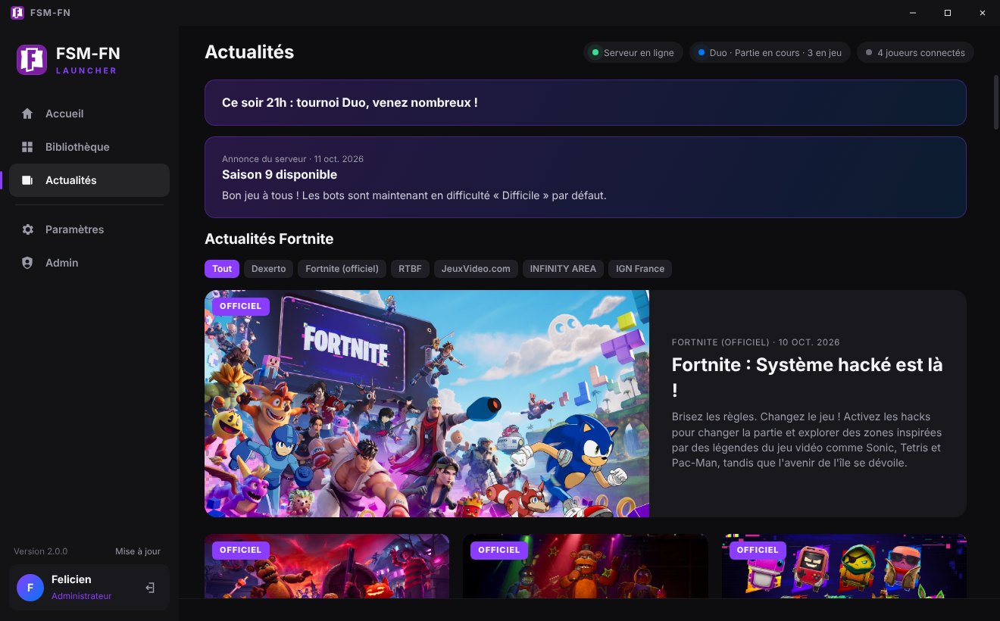
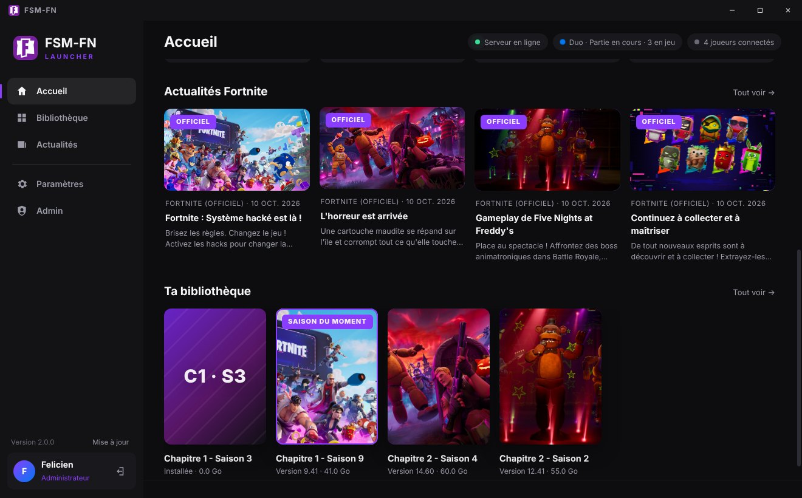
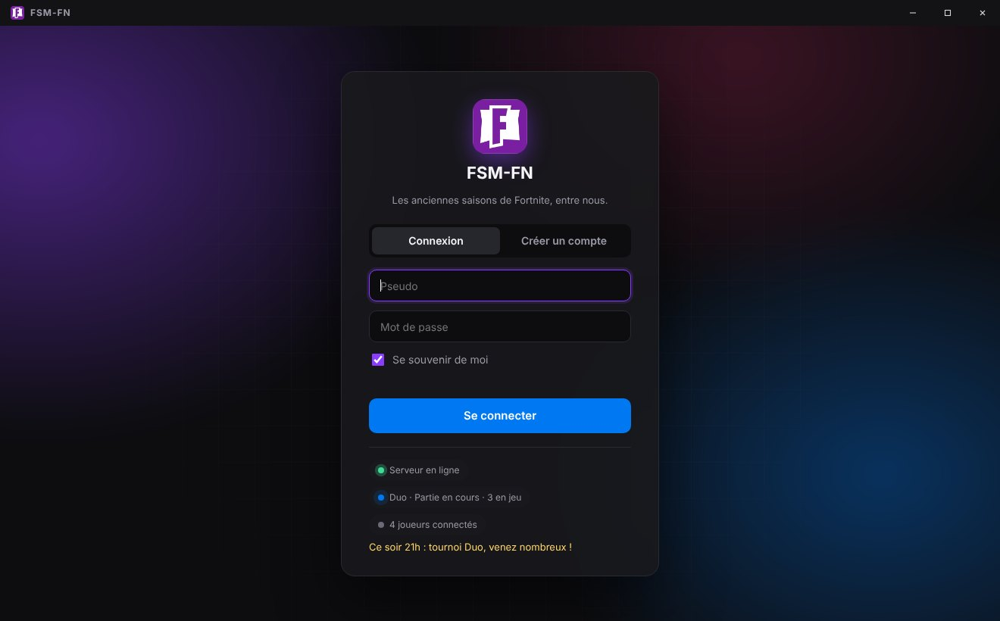
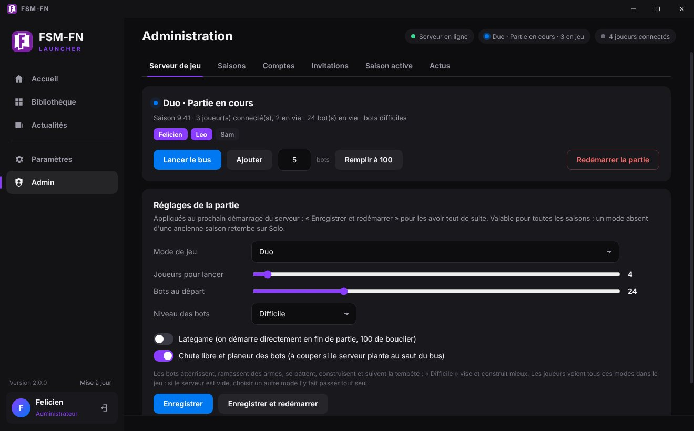
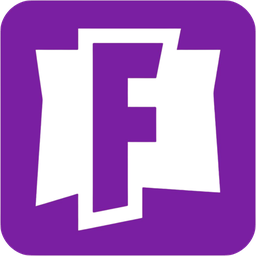

 

### [⬇&nbsp;&nbsp;Télécharger FSM-FN pour Windows](https://github.com/felicienradio/fsm-launcher/releases/latest)

Fichier <code>FSM-FN-Setup-&lt;version&gt;.exe</code> dans la dernière Release · installation sans droits administrateur

---

**FSM-FN** est le launcher de notre serveur Fortnite privé : on s'y connecte avec son compte, on télécharge les
anciennes saisons du jeu et on rejoint les parties hébergées sur le serveur, avec ses amis et des bots.

> [!NOTE]
> Serveur **sur invitation** : pour créer un compte, il faut un code `FSM-XXXX-XXXX` donné par un admin.

## ✨ Fonctionnalités

<table>
<tr>
<td width="50%" valign="top">

### 🏠 Accueil
Carrousel des saisons avec leur affiche, état du serveur en direct (partie en cours, joueurs, bots), dernières
actualités Fortnite et accès direct à ta bibliothèque.

### 🎮 Bibliothèque
Jaquettes des saisons, téléchargement **avec reprise**, vérification de l'intégrité (SHA-256), réparation,
désinstallation. Tu as déjà le jeu sur ton PC ? Indique simplement son dossier.

### 📰 Actualités
Les actus officielles du jeu en français, les articles des sites d'actu (flux RSS) et les annonces du serveur.

</td>
<td width="50%" valign="top">

### 🚀 Lancement en un clic
Le launcher prépare tout : connexion au serveur, outils du jeu, suivi de la partie. Il détecte aussi les fichiers
de jeu modifiés qui provoquent « Des données corrompues ont été découvertes ».

### 🔄 Toujours à jour
Mise à jour automatique en arrière-plan, installée à la fermeture du launcher (ou tout de suite avec
« Redémarrer »).

### 🛡️ Espace admin
Pilotage du serveur de jeu (mode, bots, bus, redémarrage), saisons et images, comptes (V-Bucks, casier),
invitations, actus et sources d'actualités.

</td>
</tr>
</table>

## 📸 Captures

<table>
<tr>
<td></td>
<td></td>
</tr>
<tr>
<td align="center"><b>Accueil</b> — carrousel des saisons et serveur en direct</td>
<td align="center"><b>Bibliothèque</b> — jaquettes, téléchargement, lancement</td>
</tr>
<tr>
<td></td>
<td></td>
</tr>
<tr>
<td align="center"><b>Actualités</b> — actus officielles, sites d'actu et annonces</td>
<td align="center"><b>Accueil</b> — actualités Fortnite et bibliothèque</td>
</tr>
<tr>
<td></td>
<td></td>
</tr>
<tr>
<td align="center"><b>Connexion</b> — état du serveur et message du jour</td>
<td align="center"><b>Admin</b> — partie en cours, bots et réglages</td>
</tr>
</table>

## 📦 Installation

1. Télécharge **`FSM-FN-Setup-<version>.exe`** dans la [dernière Release](https://github.com/felicienradio/fsm-launcher/releases/latest).
2. Lance-le : choisis le dossier d'installation, les raccourcis « FSM-FN » sont créés sur le Bureau et dans le menu
   Démarrer.
   Si Windows SmartScreen affiche « Windows a protégé votre ordinateur », clique sur **Informations
   complémentaires**, puis **Exécuter quand même** : l'installeur n'est pas signé par un éditeur payant.
3. Connecte-toi (ou crée ton compte avec ton code d'invitation), puis installe une saison depuis la
   **Bibliothèque**.

**Configuration requise** : Windows 10 ou 11 (64 bits), une bonne connexion et de la place sur le disque. Chaque
saison pèse de 20 à 60 Go, et le téléchargement a besoin temporairement du double.

## ❓ Questions fréquentes

<b>Le jeu se ferme au lancement ou l'antivirus bloque quelque chose</b>

Windows Defender bloque souvent les outils qui connectent le jeu au serveur. Dans **Paramètres**, clique sur
**Ajouter les exclusions** (Windows demande une confirmation), puis relance la partie.

<b>« Des données corrompues ont été découvertes »</b>

Un fichier du jeu a été ajouté ou modifié. À la fin de la partie, le launcher propose de mettre de côté les fichiers
en cause (ils sont déplacés, pas supprimés). Sinon : Bibliothèque › « … » › **Vérifier l'installation**.

<b>J'ai déjà le jeu sur mon PC</b>

Bibliothèque › bouton « … » de la saison › **J'ai déjà ce jeu sur mon PC…**, puis choisis le dossier qui contient
<code>FortniteGame</code>. Rien n'est copié ni modifié : le launcher utilise ce dossier tel quel.

<b>Mon mot de passe n'est pas accepté</b>

6 caractères minimum, sans espace, guillemet, virgule, parenthèse ni accent : il est transmis au jeu, qui coupe
la valeur sur ces caractères.

<b>Où trouver les journaux à envoyer à l'admin ?</b>

**Paramètres › Ouvrir les journaux** : <code>launcher.log</code> et <code>game.log</code> (dernière partie).

<b>Mes données sont-elles en sécurité ?</b>

Le mot de passe mémorisé est chiffré pour ta session Windows et ne quitte ton PC que pour se connecter à notre
serveur. Le launcher ne collecte rien d'autre.

## 🔁 Mises à jour

Ce dépôt ne contient que les **versions publiées** du launcher. Le launcher installé consulte ses Releases au
démarrage puis toutes les 15 minutes : chaque nouvelle version est téléchargée en arrière-plan et vérifiée, puis
installée à la fermeture.

---

 
<b>FSM-FN</b> · projet privé entre amis, sans lien avec Epic Games. Fortnite est une marque d'Epic Games, Inc.

